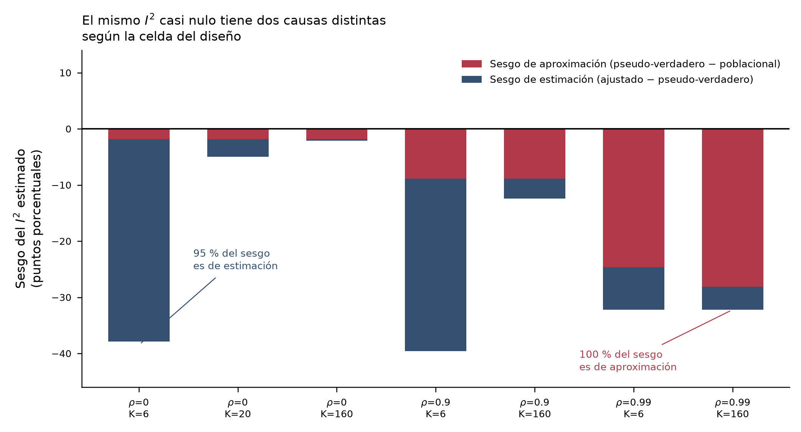
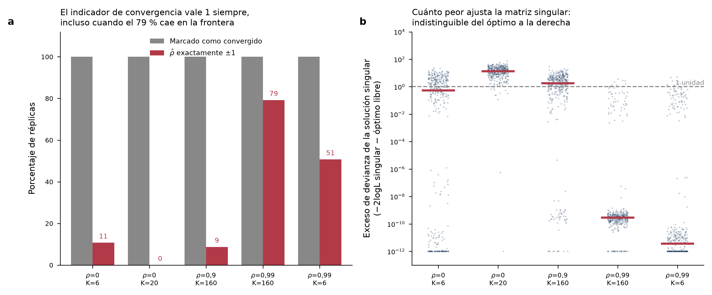
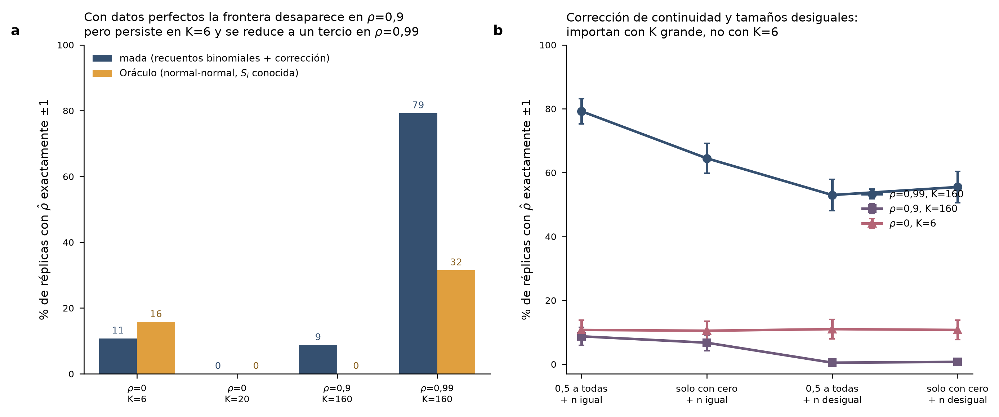
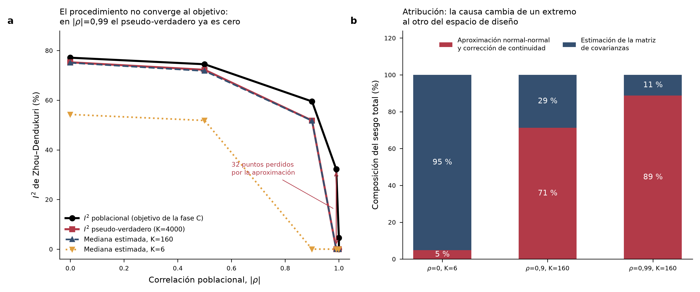

# Phase D1 — Convergence, identifiability and the estimand

**Date:** 2026-10-16 · **Package audited:** `mada` 0.5.12 · **R:** 4.5.3

Phase C established that a fitted Zhou–Dendukuri bivariate I² is frequently
near zero when the population value is substantial. Phase D1 asks *why*, and
answers it by separating three things Phase C could not: the target parameter,
the fitting approximation, and the covariance estimator.

The headline is a dichotomy. **The two scenarios Phase C highlighted have
opposite causes.** Reporting them as one phenomenon would have been wrong.

---

## 1. The estimand was not the one the estimator converges to

Phase C compared the fitted index against a *population* target built from the
generating parameters. That difference is only a bias if the procedure
converges to those parameters. It does not.

Running the identical procedure on datasets of K = 4000 studies
(`scripts/11_phase_d1_pseudotrue.R`, 5 independent large datasets per cell)
gives the **pseudo-true value** — the point the procedure actually converges
to. In the 50/50 sample scheme:

| ρ (true) | Population I² | Pseudo-true I² | τ̂²_Se / τ²_Se | Pseudo-true ρ |
|---:|---:|---:|---:|---:|
| 0.00 | 77.1 % | 75.3 % | 0.616 | 0.0002 |
| 0.50 | 74.5 % | 72.2 % | 0.628 | 0.531 |
| 0.90 | 59.5 % | 50.6 % | 0.674 | 0.945 |
| **0.99** | **32.2 %** | **0.002 %** | 0.697 | **1.000** |

Two consequences:

1. **The between-study variances are attenuated by roughly a third and this
   does not improve with K.** At K = 4000 the ratio τ̂²_Se / τ²_Se is 0.616, the
   same value seen at K = 160. The procedure is not consistent for the
   generating variances.
2. **At ρ = 0.99 the procedure converges to ρ = 1 exactly, and the pseudo-true
   index is zero.** The 88 % of near-zero estimates Phase C observed at
   K = 160 is therefore not finite-sample instability. It is where the
   procedure is heading.

In the 150/500 scheme the attenuation is milder (0.80–0.88) and the pseudo-true
ρ at 0.99 is 0.993, not 1 — the pathology is specific to small per-study
denominators.

Full table: [`results/D1_pseudotrue_values.csv`](../results/D1_pseudotrue_values.csv).

## 2. Decomposing the bias

With the pseudo-true value in hand the Phase C bias splits into

    approximation bias = pseudo-true − population
    estimation bias    = mean fitted − pseudo-true

| Scenario | Population I² | Total bias | From approximation | From estimation |
|---|---:|---:|---:|---:|
| ρ = 0, K = 6 | 77.1 % | −37.9 pp | **5 %** | **95 %** |
| ρ = 0.9, K = 160 | 59.5 % | −12.4 pp | 71 % | 29 % |
| ρ = 0.99, K = 160 | 32.2 % | −28.1 pp | **89 %** | **11 %** |

The small-K result Phase C reported is an estimation problem, as the project
claimed. The large-K result at ρ = 0.99 is almost entirely an artefact of the
fitting approximation. They support different scientific conclusions.

Table: [`results/D1_bias_decomposition.csv`](../results/D1_bias_decomposition.csv).

## 3. Why the optimiser can land exactly on the boundary

`mvmeta` parameterises Ψ = L Lᵀ with L = [[L₁₁, 0], [L₂₁, L₂₂]] and optimises L
**unconstrained**. The objective depends on L₂₂ only through
v₂ = L₂₁² + L₂₂², so it is an *even* function of L₂₂ and

> **∂(−2 log L)/∂L₂₂ = 0 at L₂₂ = 0 for every dataset.**

A singular covariance matrix — |ρ| = 1 — is therefore a stationary point of the
likelihood always, not a consequence of unusual data. Whether it attracts the
optimiser depends on the sign of the curvature there. The audit evaluates that
curvature per replicate (`scripts/12_phase_d1_audit_fns.R`,
`singular_point_diagnostics`).

| Scenario | Flagged converged | ρ̂ exactly ±1 | Singular point is a local min | Median excess deviance of singular solution |
|---|---:|---:|---:|---:|
| ρ = 0, K = 6 | 100 % | 10.8 % | 28.3 % | 0.54 |
| ρ = 0, K = 20 | 100 % | 0.0 % | 0.3 % | 13.61 |
| ρ = 0.9, K = 160 | 100 % | 8.8 % | 11.3 % | 1.75 |
| ρ = 0.99, K = 160 | 100 % | 79.3 % | 86.0 % | ≈ 0 |
| ρ = 0.99, K = 6 | 100 % | 50.8 % | 79.5 % | ≈ 0 |

**The convergence flag is 1.000 in every scenario**, including the one where
79 % of fits sit exactly on the singular boundary. The Hessian in the Cholesky
coordinates is positive definite there too (median condition number 2.6–7.7),
because L₂₂ = 0 is an interior point of that parameterisation. Standard
convergence and curvature diagnostics are therefore blind to this failure — which
is precisely why Phase C's "15,000 fits, 0 failures" could be literally true and
still uninformative. The informative quantities are |L₂₂|, the excess deviance
of the singular solution, and the range of the profile over ρ.

Note the ρ = 0, K = 6 row: the perfectly singular covariance fits only **0.54**
deviance units worse than the unconstrained optimum, and the whole profile over
ρ spans 4.29 units. With six studies the likelihood barely distinguishes a
singular covariance from the truth.

Table: [`results/D1_convergence_audit.csv`](../results/D1_convergence_audit.csv).

## 4. Oracle arm: is it the estimator or the approximation?

The oracle arm (`scripts/14_phase_d1_oracle.R`) removes the approximation
entirely: study effects come from the same latent draws, but outcomes are drawn
directly from the normal–normal model with the within-study covariance known
and supplied to the estimator. No counts, no logit transform, no continuity
correction. The estimator is the same REML objective, validated against `mada`
in `scripts/12_test_phase_d1.R`.

| Scenario | ρ̂ exactly ±1, mada | ρ̂ exactly ±1, oracle | Attribution |
|---|---:|---:|---|
| ρ = 0, K = 6 | 10.8 % | **15.8 %** | intrinsic to the covariance estimator |
| ρ = 0, K = 20 | 0.0 % | 0.0 % | — |
| ρ = 0.9, K = 160 | 8.8 % | **0.0 %** | entirely the approximation |
| ρ = 0.99, K = 160 | 79.3 % | **31.5 %** | about 60 % approximation, rest intrinsic |

With known within-study variances the estimator is consistent
(τ̂²_Se / τ²_Se = 0.993 at K = 160) and the median fitted index at ρ = 0.99 is
26 % against a population 32 % — the index behaves sensibly once the matrix is
well estimated.

**Correctness note.** A first version of this arm computed each study's
within-study variance from its own latent pᵢ. That makes Sᵢ a deterministic
function of θᵢ, so conditioning on Sᵢ is informative about θᵢ, the normal–normal
model is misspecified, and τ̂² is attenuated even with perfect data — it
converged to 0.80 at K = 4000 instead of 1. The arm now draws the
variance-generating proportions from an independent copy of the same marginal
distribution; the consistency check then gives 1.000 at K = 1000 and 1.005 at
K = 4000.

Tables: [`results/D1_oracle_arm.csv`](../results/D1_oracle_arm.csv),
[`results/D1_oracle_summary.csv`](../results/D1_oracle_summary.csv).

## 5. Design factors Phase C held fixed

### 5.1 The continuity correction contaminates the whole dataset

`reitsma(correction.control = "all")` adds 0.5 to **every** table as soon as a
single zero cell appears anywhere in the dataset. The probability of at least
one zero cell grows with K, so in the 50/50 scheme the entire dataset is
perturbed in 38 % of replicates at K = 6 but in **100 %** at K = 160. That is
the mechanism by which the variance attenuation fails to improve with more
studies: more studies means more chances that one zero contaminates all of them.

### 5.2 Effect of relaxing both constants

| Scenario | 0.5 to all, equal n | only zero tables, equal n | 0.5 to all, unequal n | only zero tables, unequal n |
|---|---:|---:|---:|---:|
| ρ = 0.99, K = 160 | 79.3 % | 64.5 % | 53.0 % | 55.5 % |
| ρ = 0.9, K = 160 | 8.8 % | 6.8 % | 0.5 % | 0.8 % |
| ρ = 0, K = 6 | 10.8 % | 10.5 % | 11.0 % | 10.8 % |

(Monte Carlo SE ≤ 2.5 pp, 400 replicates per cell, common random numbers.)

Both constants matter at large K and neither matters at K = 6 — consistent with
the attribution in §4. Log-normal study sizes nearly eliminate the ρ = 0.9 case.

Table: [`results/D1_design_factor_summary.csv`](../results/D1_design_factor_summary.csv).

## 6. Reproducibility infrastructure

`scripts/10_rng_streams.R` replaces the single `set.seed()` of Phase C with
per-replicate L'Ecuyer-CMRG streams indexed by (scheme, replicate), plus common
random numbers across ρ and K via inversion sampling. Consequences: a
1000-replicate run contains the 100-replicate run as an exact subset, any single
replicate can be re-run in isolation from its recorded seed, and comparisons
between design cells are not inflated by independent Monte Carlo noise
(cor(FP | ρ=0, FP | ρ=0.9) = 0.52 under CRN against 0.16 with independent
uniforms). Eleven automatic checks:
[`results/rng_nesting_check.csv`](../results/rng_nesting_check.csv).

`scripts/12_test_phase_d1.R` proves the objective used for the Hessian and
profile diagnostics is the one `mada` maximises: zero gradient at `mada`'s
optimum (max |grad|/scale ≤ 2.4 × 10⁻⁶), recovery of `fit$Psi` to ≤ 1.1 × 10⁻⁵,
and identical GLS coefficients, on three datasets with and without zero cells.
Results: [`results/D1_likelihood_validation.csv`](../results/D1_likelihood_validation.csv).

## 7. Synthesis

1. The Zhou–Dendukuri index is not the problem in the large-K cells. With a
   well-estimated covariance matrix it tracks its population value.
2. The dominant cause at large K with |ρ| near 1 is the normal–normal
   approximation together with a continuity correction whose reach grows with K.
3. The dominant cause at K = 6 is boundary attraction in the bivariate
   covariance estimator, which survives perfect data and is explained by the
   singular matrix being a stationary point of the likelihood for every dataset.
4. `converged == TRUE` certifies nothing here. Any future report must give the
   fraction of boundary solutions alongside it.

## 8. Limitations

- Pseudo-true values use 5 large datasets per cell. At ρ = ±0.9999 and ±1 in the
  150/500 scheme the Monte Carlo SE of the pseudo-true I² reaches 0.07–0.08, so
  those two cells are indicative only; the cells driving the conclusions have
  MCSE ≤ 0.009.
- 400 replicates give a Monte Carlo SE of at most 2.5 pp on the boundary
  fractions. Differences smaller than ~5 pp should not be interpreted.
- The audit covers the 50/50 scheme only for the convergence, factor and oracle
  experiments; the 150/500 scheme appears in the pseudo-true table.
- The oracle arm isolates the approximation but is not a binomial–normal GLMM.
  Fitting the counts directly remains Phase D2.
- Only `bscov = "unstructured"` with REML is examined. Alternative covariance
  parameterisations might not place a stationary point at the singular matrix,
  which is itself a question worth asking in D2.
- No assumption or residual diagnostics were computed for the fitted models.

## 9. What D2 should now do

The remaining open question is narrow: at K = 6 with moderate ρ, does a
binomial–normal GLMM fitted to the counts avoid the boundary attraction that
survives in the oracle arm? If it does not, the limitation is general to
bivariate covariance estimation with few studies and should be reported as such
rather than as a property of `mada` or of the Zhou–Dendukuri index.

A second, cheaper question follows from §3: does a parameterisation in which
the singular matrix is *not* a stationary point (for instance a Fisher-z
transform of ρ) change the boundary frequency? That is a one-day experiment and
would sharpen the recommendation considerably.
